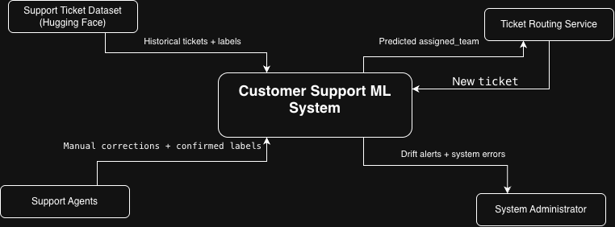
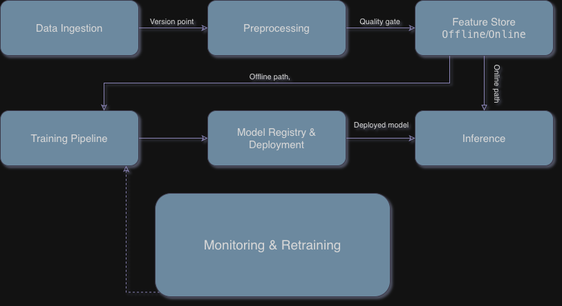
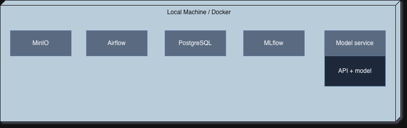

# Customer Support Query Classification

## 1 Overview

Customer support services always receive a lot of different types of issues. 
And separating each of them manually, for each team is simply unrealistic. 
So in terms of this course, we will use **machine learning** for analyzing customer issues `issue_description` and we will route them to support team `assigned_team`. 

## 2 Motivation

Customer support requests arrive regularly therefore, 
the system must analyze them quickly in real time. 
After analysis, the request will be forwarded to the appropriate support team.
If the system makes an incorrect prediction the receiving team/support manager
can reassign a request to another team.

## 3 Success metrics

1. Share of requests that do not require manual redirection **$\geqslant$ 80%**
2. **Macro F1-score** for prediction `assigned_team` **$\geqslant$ 0.80**
3. p95 prediction latency **$\leqslant$ 500 ms**

## 4 Requirements and constraints

### Functional requirements

1. The system must accept new customer support requests containing an `issue_description`
2. The system must analyze each requests and predict the appropriate `assigned_team`
3. The system must return the predicted team to the routing service
4. The system must allow support agents to manually assign incorrectly routed tickets
5. The system must store predictions and manual corrections for future evaluation

### Non-functional requirements

|            Requirement            | Description                                                                              |
|:---------------------------------:|:-----------------------------------------------------------------------------------------|
|             Freshness             | New tickets should be available for prediction within 5 seconds after creation           |
|      Latency and Throughput       | p95 prediction latency $\leqslant$ 500 ms                                                |
|     Availability and Fallback     | Target availability $\geqslant$ 99%                                                      |
|          Reproducibility          | Training results must be reproducible using the same code version, data version          |
|           Adaptability            | New requests should be ingested daily. Model retraining should be evaluated monthly      |
| Bservability without ground truth | Monitor prediction counts, latency, errors, and changes in input data distribution daily |
|    Cost and resource ceilings     | The system should run locally with up to 4 CPU cores and 8 GB RAM                        |

### In scope

1. Automatic classification of customer requests based on `issue_description`
2. Manual reassignment of incorrectly classified tickets
3. Updating the model using new support ticket data

### Out of scope

1. Automatically generating responses to customer requests.
2. Automatically resolving customer issues

## 5.1 Problem statement

Our task is a multiclass classification problem. 
The system will analyze customer support requests `issue_description` and predicts the appropriate support team `assigned_team. \
An alternative approach is manual work by the support team. However, this approach is time-consuming and may lead to human errors.

## 5.2 Data

Dataset: https://huggingface.co/datasets/s2pidape/support-ticket-dataset \
This dataset contains: \
`created_at` -- time stamp when request was created (YYYY-MM-DD hh:mm:ss) \
`issue_description` -- info about customer issue \
`assigned_team` -- the support team assigned to handle the request

The data covers three years, from 2022-01-01 00:04:00 to 2024-12-30 23:58:00. \
The dataset itself contains 37 columns and 1,500,000 rows.

### Data arrival pattern

Customer support requests arrive at irregular intervals, and multiple requests may have the same timestamp. \
Since we use a historical dataset, new ticket arrivals will be simulated using the `created_at` timestamps.

### Labels 

The target variable is `assigned_team`, which represents the team responsible for handling a customer request. \
When a new ticket is created, the model predicts the appropriate team. If the prediction is incorrect, a support agent can manually reassign the ticket. \
The correct support team is confirmed after human review or ticket resolution. 

### Split Data 

- train -- 2022-01-01 to 2023-12-31 
- val -- 2024-01-01 to 2024-06-30 
- test -- 2024-07-01 to 2024-12-30

### Training 

During training, the model uses historical requests with known `assigned_team`. \
During serving, the model receives a new `issue_description` and predicts the appropriate `assigned_team`. \
The `created_at` timestamp is used for chronological data splitting, and is not used as a model feature. 

## 5.3 Techniques

Step-1: As a baseline, we will use **DummyClassifier** with strategy="most_frequent" from scikit-learn. \
Step-2: We will use TF-IDF + Logistic Regression.

Features -- `issue_description`, target -- `assigned_team`.

## 5.4 Experimentation and validation

We will use the time-based data split described in _Section 5.2_ to avoid data leakage. \
Model performance will be evaluated using **Macro F1-score**. \
New models will be compared with the current model on the same validation dataset. \
The test dataset will be used for final evaluation.

## 5.5 Human in the loop

1. The system administrator reviews data drift alerts.
2. The ML engineer evaluates and approves new model versions before deployment.
3. Support agents or managers can manually reassign incorrectly classified tickets to another team.

## 6.1 High-level design

### system context

 

### data flow diagram

### deployment

## 6.2 Infra

## 6.2 Infra

| Component              | Local                    | AWS equivalent          |
|------------------------|--------------------------|-------------------------|
| Object storage         | MinIO-compatible storage | Amazon S3               |
| Data versioning        | DVC                      | S3 remote               |
| Database               | PostgreSQL               | Amazon RDS              |
| Orchestration          | Apache Airflow           | Amazon MWAA             |
| ML pipelines           | Airflow DAG              | SageMaker Pipelines     |
| Model registry         | MLflow                   | SageMaker with MLflow   |
| Feature store          | Feast                    | SageMaker Feature Store |
| Container registry     | Docker Hub               | Amazon ECR              |
| Kubernetes cluster     | Minikube                 | Amazon EKS              |
| Model monitoring       | Evidently                | SageMaker Model Monitor |
| Metrics and dashboards | Prometheus, Grafana      | Amazon CloudWatch       |
| Vector store           | pgvector                 | OpenSearch Serverless   |
| LLM inference          | API-based LLM            | Amazon Bedrock          |

## 6.3 Performance

## 6.3 Performance

The system should process at least 3 requests per second, with p95 prediction latency **$\leqslant$ 500ms**. \
We will use real-time inference because customer support tickets should be assigned to the appropriate team shortly after creation.
Historical data will be processed in daily batches for model training. 

## 6.4 Security  

API keys and passwords will be stored in environment variables and will not be committed to GitHub. \
Only authorized services will be allowed to access the Prediction API.

## 6.5 Data privacy

## 6.6 Monitoring and alarms

## 6.7 Cost

## 6.8 Integration points

## 6.9 Risks and uncertainties

## 7.1 Risks and uncertainties

## 7.2 7.3 Placeholders

## 7.4 Milestones

